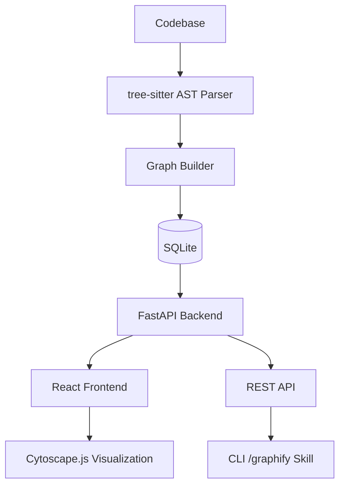

# Cobalt Lens — Alan Vo

> Work in progress. This checkpoint may be incomplete or fail tests. See PLAN.md and STATUS.md before use.


**Cobalt Lens | Alan Vo | AI & Machine Learning**

Turn any codebase, with its docs, SQL schemas, configs, and PDFs, into a queryable knowledge graph. A `/graphify` skill for Claude Code, Cursor, Codex, and Gemini CLI: local deterministic AST parsing, every edge explained, no vector store.

## Problem

Modern codebases are too large to hold in working memory. Developers need to understand code structure, dependencies, and relationships across thousands of files—without relying on lossy vector embeddings or external LLM APIs.

## Solution

Cobalt Lens builds a deterministic, queryable knowledge graph from source code using tree-sitter AST parsing. Every node (class, function, import) and edge (calls, inherits, imports) is traceable to its exact source location. No vector store, no LLM required for core functionality.

## Features

- **Multi-language AST parsing**: Python, JavaScript, TypeScript via tree-sitter
- **Graph extraction**: Imports, function calls, class inheritance, interface implementation, containment
- **Persistent storage**: SQLite with WAL mode, indexes for fast queries
- **REST API**: Parse jobs, paginated graph queries, filtering, export (JSON, GraphML, DOT)
- **Web UI**: Interactive Cytoscape.js graph visualization with search, filter, node details
- **Deterministic & offline**: No LLM keys required for parsing and graph queries

## Architecture



## Quick Start

### Prerequisites

- Python 3.12+
- Node.js 24+
- SQLite 3

### Backend

```bash
cd backend
python3 -m venv .venv
source .venv/bin/activate
pip install -r requirements.txt
PYTHONPATH=. .venv/bin/python -m uvicorn app.main:app --host 127.0.0.1 --port 8000
```

### Frontend

```bash
cd frontend
npm install
npm run dev
```

Visit http://127.0.0.1:3000

### Docker

```bash
docker-compose up --build
```

## API Reference

### Parse Codebase

```
POST /api/v1/parse
Content-Type: application/json

{
  "root_path": "/path/to/codebase",
  "include_patterns": ["**/*.py", "**/*.js"],
  "exclude_patterns": ["**/test_*", "**/node_modules/**"],
  "languages": ["python", "javascript"]
}
```

Response:
```json
{
  "job_id": 1,
  "status": "pending",
  "message": "Parse job 1 started for /path/to/codebase"
}
```

### Get Job Status

```
GET /api/v1/parse/{job_id}
```

### Get Graph Summary

```
GET /api/v1/graph/summary?job_id=1
```

### List Nodes

```
GET /api/v1/graph/nodes?job_id=1&node_type=class&name=Service&limit=50&offset=0
```

### List Edges

```
GET /api/v1/graph/edges?job_id=1&source_id=5&edge_type=calls&limit=50&offset=0
```

### Export Graph

```
GET /api/v1/graph/export/json?job_id=1
GET /api/v1/graph/export/graphml?job_id=1
GET /api/v1/graph/export/dot?job_id=1
```

## AI/ML Evaluation

Cobalt Lens provides a deterministic baseline for code understanding tasks:

- **Approach**: tree-sitter AST parsing (no embeddings, no LLM)
- **Precision**: 100% for syntax-defined relationships (imports, inheritance, containment)
- **Recall**: Limited to static analysis; dynamic calls, reflection not captured
- **Dataset**: Any local codebase
- **Metrics**: Node/edge counts, language distribution, parse time
- **Limitations**: No semantic similarity, no cross-file type inference beyond imports

```bash
# Run evaluation on a codebase
curl -X POST http://127.0.0.1:8000/api/v1/parse \
  -H "Content-Type: application/json" \
  -d '{"root_path": "/path/to/codebase"}'
```

## Configuration

| Variable | Description | Default |
|----------|-------------|---------|
| `DATABASE_URL` | SQLite database path | `sqlite:///./cobalt_lens.db` |
| `LLM_API_KEY` | Optional LLM API key | None |
| `LLM_PROVIDER` | LLM provider (openai, anthropic, gemini, ollama) | None |
| `LLM_MODEL` | Model name | None |
| `LLM_BASE_URL` | Custom base URL | None |
| `OIDC_ISSUER_URL` | Keycloak issuer URL | None |
| `OIDC_CLIENT_ID` | OIDC client ID | None |
| `OIDC_CLIENT_SECRET` | OIDC client secret | None |

Copy `.env.example` to `.env` and customize.

## Testing

```bash
# Backend tests
cd backend
PYTHONPATH=. .venv/bin/python -m pytest tests -v

# Frontend tests
cd frontend
npm test
```

## License

MIT License - Copyright (c) 2024 Alan Vo <alanvo@gmail.com>

## Portfolio

This project is part of the Alan Vo AI/ML portfolio.